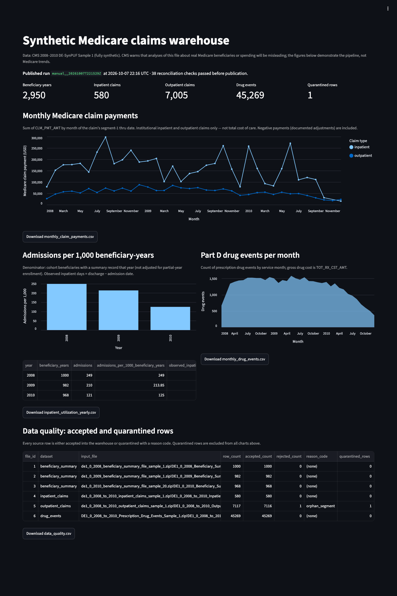
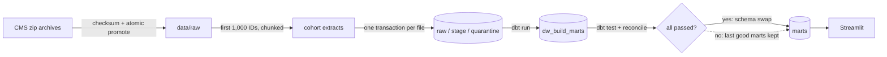

# Healthcare Claims Data Warehouse

This is a batch data pipeline that turns CMS synthetic Medicare claims into a tested dimensional
warehouse and a dashboard. It does five things:

- Downloads the source files and verifies each one against a recorded checksum.
- Selects a reproducible cohort of 1,000 beneficiaries.
- Validates every row, and quarantines bad rows with a reason code instead of dropping them.
- Builds dimension and fact tables with dbt.
- Publishes the result only after every row and every dollar reconciles exactly.

Airflow runs the steps, PostgreSQL stores the data, and a Streamlit dashboard reads the
published tables.

> **About this project.** This is a self-directed portfolio project, not academic coursework.
> It was implemented with an AI coding assistant (Claude Code), working from a written build
> specification ([`CLAUDE_BUILD_PROMPT.md`](CLAUDE_BUILD_PROMPT.md),
> [`docs/BUILD_GUIDE.md`](docs/BUILD_GUIDE.md)). The results below come from a recorded local run.
> The data is fully synthetic, and nothing here describes real Medicare beneficiaries or spending.



## Results from the recorded run

The run used commit `61313ec` on Docker Desktop on an Apple M1 Mac (8 GB RAM, 4 GB given to
Docker). Every number below comes from [`reports/metrics.json`](reports/metrics.json).

| Measure | Value |
|---|---|
| Cohort | 1,000 beneficiaries (sha256 `20841988…`), 2,950 beneficiary-years |
| Source rows staged | 55,916 rows from 6 CMS files |
| Accepted / quarantined | 55,915 accepted; 1 quarantined (`orphan_segment`) |
| Warehouse facts | 580 inpatient claims, 7,005 outpatient claims, 45,269 drug events |
| Medicare claim payments | Inpatient $5,565,690.00; outpatient $2,016,980.00 |
| dbt data tests | 48 of 48 passed |
| Reconciliation checks | 38 of 38 passed (exact decimal, tolerance $0.00) |
| Step time per DAG run | 36 s for run B, which loaded the drug file; 27 s for rerun C. Cohort extraction from the 425 MB drug CSV is about 18 s of each. |

The recorded run was three DAG runs in a row, triggered through the Airflow scheduler:

| Run | What happened |
|---|---|
| **A**: load failure injected into the drug-event file | `stage` failed and was **not retried**, because it was a data failure, not a transient one. dbt, reconcile and publish were skipped, and the DAG run was marked failed. The drug file was registered as `failed` with **0 rows committed**. Nothing was published. |
| **B**: normal run | Only the drug file reloaded (attempt 2). The five files committed during run A were skipped. All checks passed and the marts were published. |
| **C**: identical rerun | All 6 files were skipped. The new marts have **exactly the same row counts and totals** as the marts they replaced (`published_equals_previous: true`). |

Per-run reports are in [`reports/runs/`](reports/runs/), and test evidence is in
[`reports/evidence/`](reports/evidence/). Full write-up: [docs/RESULTS.md](docs/RESULTS.md).

## How it works



- **Every row is accounted for.** Each source row is either accepted or quarantined with a
  reason code, such as `invalid_date`, `duplicate_key_existing:exact`, `orphan_segment` or
  `no_beneficiary_year`. A file that doesn't balance is never committed.
- **Reruns are safe.** Input files are identified by checksum, so presenting the same file again
  loads nothing new.
- **Interrupted loads leave nothing behind.** Each file loads in a single transaction. A test
  kills the loader with `SIGKILL` partway through a file and confirms that zero rows were committed.
- **Publishing is gated.** dbt builds into a separate schema. Only a build that passes dbt tests
  and reconciliation is swapped into `marts`, and the swap happens in one transaction.
- **Database roles are least-privilege.** The loader, transformer and dashboard each have their
  own role, and the dashboard can read only the published marts.
- **Retries are only for temporary problems.** The CLI exits with code 75 for network or database
  outages, which Airflow retries. Data and check failures fail immediately.

Details: [Architecture](docs/ARCHITECTURE.md) · [Data model and rules](docs/DATA_DICTIONARY.md) ·
[Validation](docs/VALIDATION_PLAN.md) · [Deployment record](docs/DEPLOYMENT.md)

## Data

[CMS 2008–2010 Data Entrepreneurs' Synthetic Public Use File (DE-SynPUF), Sample 1](https://www.cms.gov/data-research/statistics-trends-and-reports/medicare-claims-synthetic-public-use-files/cms-2008-2010-data-entrepreneurs-synthetic-public-use-file-de-synpuf/de10-sample-1).
The pipeline uses the beneficiary summary files (2008, 2009 and 2010) and the inpatient,
outpatient and Part D drug event files. The archives (about 150 MB) are downloaded by `make seed`
and are not stored in this repository. Their URLs, sizes and SHA-256 checksums are in
[`config/sources.yaml`](config/sources.yaml).

Things the data required:

- **Claim segments.** 68 inpatient and 11,253 outpatient rows in the full files are second
  segments of a claim. They carry payments but no dates, so the pipeline rolls them up into the
  claim. A second segment with no first segment is quarantined.
- **Negative payments.** Negative claim payments are valid according to the CMS codebook
  (sections IP-7 and OP-7), so they are kept and counted.
- **Mislabeled link.** The CMS link for the 2010 beneficiary file ends in `sample_20`, but the
  archive contains Sample 1.

CMS states that DE-SynPUF has very limited inferential value. The dashboard figures demonstrate
the pipeline, not Medicare trends.

## Tech stack

Python 3.12 · pandas 3.0 · SQLAlchemy 2.1 · psycopg 3.3 · PostgreSQL 17.11 · dbt Core 1.12 with
dbt-postgres 1.11 · Apache Airflow 3.3.2 · Streamlit 1.65 · Docker Compose · pytest · Ruff ·
GitHub Actions · uv (lockfile)

## Run it

You need Docker with Compose, [uv](https://docs.astral.sh/uv/), make, and about 6 GB of free disk (about 4.7 GB of images plus 150 MB of CMS archives).

```bash
cp .env.example .env    # then replace every "change-me" value
make setup              # check tools and .env, install locked dependencies
make up                 # build the image, start 4 services (waits for health checks), migrate
make seed               # download and verify CMS archives, build the cohort
make pipeline           # trigger the Airflow DAG and wait for it to finish
make report             # write reports/metrics.json and reports/summary.md
make test               # unit tests plus integration/recovery tests (uses a separate test database)
make down               # stop services; data volumes are kept
```

- Dashboard: http://127.0.0.1:8501
- Airflow: http://127.0.0.1:8080 (user `admin`; the password is in
  `/opt/airflow/simple_auth_manager_passwords.json.generated` inside the `airflow` container)

To demonstrate failure recovery, run
`scripts/run_dag.sh '{"fail_after_chunks": 1, "fail_dataset": "drug_events"}'`, then
`make pipeline`.

These commands were run in this order on the machine described in
[docs/DEPLOYMENT.md](docs/DEPLOYMENT.md). On a Mac, keep it awake during long runs, for example
with `caffeinate -s make pipeline`. Host sleep pauses Docker.

## Tests

| Suite | What it proves |
|---|---|
| 17 unit tests | Validation rules and reason codes, DDL matches config, deterministic fixtures, cohort selection, checksum mismatch never reaches `data/raw` |
| 8 integration and recovery tests | Fixture run equals expected totals, rerun changes nothing, incremental batch, 8 kinds of bad rows each get the right reason code, dashboard role can't read stage or raw, injected failure rolls back, SIGKILL mid-load leaves zero rows, tampered build fails reconciliation and isn't published |
| 48 dbt tests | Key uniqueness, foreign keys to beneficiary-year and date, no negative length of stay, segment payments roll up |
| CI | Lint, all of the above against a PostgreSQL service container, a full fixture pipeline, image build, lockfile check, DAG import check |

## Repository layout

```text
src/claims_dw/     pipeline: acquire, cohort, validate, ingest, reconcile, publish, report, CLI
config/            sources (URLs + checksums), file contracts, field mapping
migrations/        ops/raw/stage tables and role grants (raw/stage DDL generated from config)
dbt/               staging, intermediate and mart models, generic and singular tests
dags/              Airflow DAG
app/               Streamlit dashboard
tests/             unit and integration/recovery tests
scripts/           DAG trigger, env check, DAG import check, headless screenshots
reports/           metrics from the recorded run and test evidence
docs/              architecture, data model, validation, deployment, results, original build guide
```

## Limitations

- The cohort is the first 1,000 beneficiary IDs in sorted order, not a random sample. The full
  Sample 1 run was not attempted on this 8 GB machine.
- Carrier (physician) claims aren't loaded, so payments cover institutional claims only and are
  not total cost of care.
- The admissions-per-1,000 denominator isn't adjusted for partial-year enrollment or death.
- This is a single-node local deployment. No cloud deployment, high availability or production
  use is claimed. No regulatory-compliance claim is made.
- Airflow runs in `standalone` mode, which is meant for development.

## License

No license has been selected yet. Third-party data and tools keep their own terms; see
[docs/SOURCES.md](docs/SOURCES.md).
