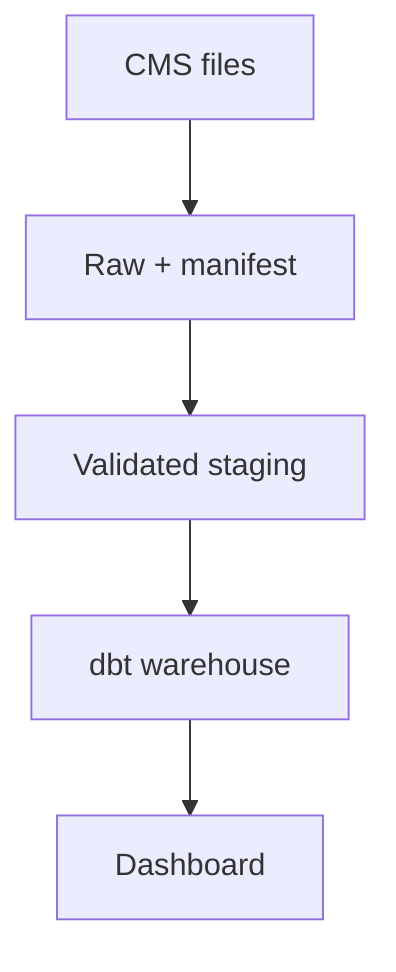

# Architecture

## Boundaries

Raw inputs are retained unchanged with checksums. Accepted processing outputs and rejected
records remain separately traceable to a source and run. Publication occurs only after checks pass.
Persistent database volumes survive container restarts. Dashboard access uses a read-only role.

## Technology roles

Python, pandas, SQLAlchemy, PostgreSQL, dbt Core + dbt-postgres, Apache Airflow, Docker Compose, Streamlit, pytest, GitHub Actions

Use Python for ingestion/processing, PostgreSQL for durable storage, Docker Compose for local
services and pytest/GitHub Actions for verification. Follow project-specific steps for other tools.
Separate orchestration metadata from domain data. Document service dependencies and host/container
addresses after implementation; `localhost` in a container refers to that container.
