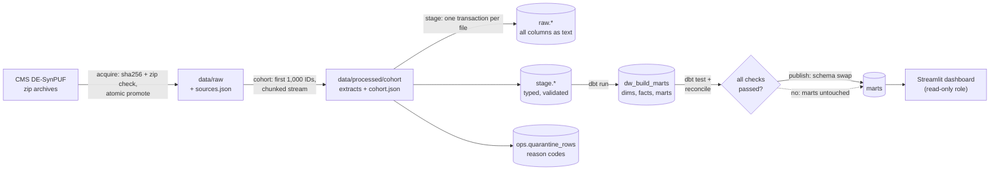

# Architecture

## Services (Docker Compose)

| Service | Image | Role | Host port (127.0.0.1 only) |
|---|---|---|---|
| `warehouse-db` | `postgres:17.11-alpine` | Warehouse: `ops`, `raw`, `stage`, `dw_build_*`, `marts` schemas | 55432 |
| `airflow-db` | `postgres:17.11-alpine` | Airflow metadata only (separate from domain data) | not exposed |
| `airflow` | `claims-dw:local` (from `apache/airflow:3.3.2-python3.12`) | `airflow standalone`, LocalExecutor, runs the `claims_pipeline` DAG | 8080 |
| `dashboard` | `claims-dw:local` | Streamlit app over the published `marts` schema | 8501 |

Inside the network, services reach the warehouse at `warehouse-db:5432`; from the host it is
`127.0.0.1:55432`. Database data lives in named volumes, so `make down` keeps it.

The pipeline (pandas, SQLAlchemy, psycopg, dbt, Streamlit) is installed in its own virtualenv,
`/opt/claims-dw/venv`, from hash-checked `requirements.lock.txt`. Airflow tasks call the
`claims-dw` CLI in that virtualenv, so Airflow's pinned dependencies and dbt's never mix.

## Database roles

| Role | Can do |
|---|---|
| `warehouse_admin` | Container superuser; used only for migrations and tests |
| `claims_loader` | Write `raw`, `stage`, `ops.ingestion_files`, `ops.quarantine_rows`, run tracking |
| `claims_transformer` | Read `raw`/`stage`/`ops`; create dbt schemas; write reconciliation results; publish |
| `claims_dashboard` | Read the published `marts` schema only (granted at publish time) |

## Commit boundaries and recovery

1. **Acquire**: download to `data/raw/.partial/*.part`, verify the recorded sha256 and zip
   integrity, then `os.replace` into `data/raw`. A bad or partial download never becomes a source.
2. **Register**: each input file is a row in `ops.ingestion_files`, unique on
   `(sha256, dataset_version)`. Registration commits on its own as `loading`. A file already
   `loaded` is skipped, so rerunning the same input adds nothing.
3. **Load one file in one transaction**: COPY raw rows, type and validate them, quarantine
   invalid rows, run the cross-row checks (duplicate keys, orphan claim segments, a
   beneficiary-year for every claim), insert accepted rows into `stage`, and mark the registry row
   `loaded`, then commit. A crash or error rolls the whole file back. The registry row stays
   `loading` or `failed`, and the next run loads the file from scratch.
4. **Build, then publish**: dbt builds into `dw_build_marts`. `dbt test` and the reconciliation
   step check that build. `publish` refuses to run unless this run recorded reconciliation results
   and every one passed. It then swaps schemas in one transaction (`marts` becomes
   `marts_previous`, `dw_build_marts` becomes `marts`). A failed run never replaces the last good marts.

## Orchestration

`dags/claims_pipeline.py` chains `acquire → cohort → stage → dbt_run → dbt_test → reconcile →
publish`, plus `mark_run_failed` (trigger rule `one_failed`). The CLI exits with code 75 for
transient problems (network, database unreachable) and 1 for data, contract or check failures.
The DAG retries only exit code 75 (`AirflowException`). Everything else fails the task
immediately (`AirflowFailException`).
